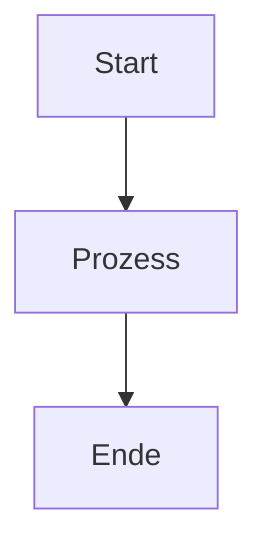

# Abbildungen & Tabellen – Empfehlungen für Handout & Leitfaden

## Übersicht

Dieses Dokument beschreibt, **wo Visualisierungen sinnvoll sind** und **wie du sie erstellen kannst**. Du studierst Informatik und reichst dies bei einem Professor ein – die Visualisierungen sollten also professionell und wissenschaftlich wirken, nicht „aus Paint".

---

## 📊 HANDOUT.md – Empfehlung nach Kapitel

### Kapitel 1: Direct Boot & Datenschutz
**→ 2 Visualisierungen sinnvoll**

#### 1.1 Sequenzdiagramm: Boot-Timeline
**Was**: Zeigt den zeitlichen Ablauf von Boot über Alarm bis zur Benachrichtigung
**Format**: UML Sequenzdiagramm
```
Zeit    | System          | App             | Speicher
--------|-----------------|-----------------|------------------
0:00    | Power On        | -               | -
0:05    | Kernel Boot     | -               | Device Encrypted verfügbar
0:10    | LOCKED_BOOT_... | BootReceiver    | Liest Alarm-IDs von DE
0:15    | Alarm triggert  | AlarmReceiver   | Zeigt generische Meldung
0:20    | User entsperrt  | MainActivity    | Credential Encrypted verfügbar
0:25    | Benachrichtigung| Zeigt Details   | Vollständige Medikamentendaten
```

**Wie erstellen**: 
- **PlantUML** (Text-basiert, professionell): [plantuml.com/de/](https://plantuml.com/de/)
  ```
  @startuml Direct Boot Timeline
  actor User
  participant System
  participant BootReceiver
  participant AlarmReceiver
  participant MainActivity
  
  System -> BootReceiver: LOCKED_BOOT_COMPLETED
  BootReceiver -> BootReceiver: Liest Alarm-IDs (DE Storage)
  ... Time passes ...
  System -> AlarmReceiver: Alarm triggert
  AlarmReceiver -> AlarmReceiver: Zeige "Zeit für Medikament!" (generisch)
  User -> System: Entsperrt Gerät
  System -> MainActivity: Credential Encrypted verfügbar
  @enduml
  ```
- **Draw.io** (Grafisch, auch professionell): [draw.io](https://draw.io/)
  - Datei → New Diagram → UML Sequence
  - Actors und Objekte hinzufügen
  - Arrows und Messages verbinden
  - Exportieren als PNG/SVG

#### 1.2 Datenspeicherung-Tabelle
**Was**: Vergleich: Was wird in CE vs. DE gespeichert?
**Format**: Markdown-Tabelle

```markdown
| Datentyp | Credential Encrypted (CE) | Device Encrypted (DE) |
|----------|---------------------------|----------------------|
| Medikamentennamen | ✅ Ja | ❌ Nein |
| Dosierung | ✅ Ja | ❌ Nein |
| Einnahmhistorie | ✅ Ja | ❌ Nein |
| Alarm-ID | ✅ Ja | ✅ Ja |
| Nächster Trigger-Zeitpunkt | ✅ Ja | ✅ Ja |
| Benutzerprofi | ✅ Ja | ❌ Nein |
| **Verfügbar nach...** | **1. Unlock** | **Boot (sofort)** |
```

**Wie erstellen**: 
- Direkt in Markdown (sieh oben)
- Oder in Draw.io → Insert → Table

---

### Kapitel 2: Architektur & Clean Code
**→ 1-2 Visualisierungen (verbessern das bestehende ASCII-Diagramm)**

#### 2.1 Layered Architecture Diagram (Professionelle Version)
**Was**: Deine ASCII-Diagramm-Struktur, aber als echtes Diagramm
**Format**: Schichtendiagramm mit Abhängigkeitsannotationen

**Wie erstellen**:
- **Draw.io**: Rechtecke übereinander → Farben für Schichten
- **PlantUML**:
  ```
  @startuml MediReminder Architecture
  package "Presentation Layer" {
    [HomeScreen]
    [MedicationsScreen]
    [HistoryScreen]
    [SettingsScreen]
  }
  
  package "ViewModel Layer" {
    [MedicationViewModel]
    [HistoryViewModel]
    [SettingsViewModel]
  }
  
  package "Domain Layer" {
    [Medication Model]
    [MedicationSchedule Model]
    [Use Cases]
  }
  
  package "Repository Layer" {
    [MedicationRepository]
    [ScheduleRepository]
  }
  
  package "Data Layer" {
    [Room Database]
    [DataStore]
  }
  
  HomeScreen --> MedicationViewModel
  MedicationViewModel --> MedicationRepository
  MedicationRepository --> "Medication Model"
  MedicationRepository --> "Room Database"
  @enduml
  ```

#### 2.2 Dependency Injection Graph
**Was**: Zeigt, wie Hilt die Abhängigkeiten auflöst
**Format**: Dependency Graph

**Wie erstellen**:
- **Graphviz** (Text-basiert, sehr professionell):
  ```
  digraph DependencyInjection {
    rankdir=LR;
    node [shape=box, style=filled, fillcolor=lightblue];
    
    AppModule -> AppDatabase;
    AppModule -> MedicationDao;
    AppModule -> MedicationRepository;
    AppDatabase -> MedicationDao;
    MedicationRepository -> MedicationViewModel;
    AlarmScheduler -> AndroidAlarmScheduler;
    AndroidAlarmScheduler -> MedicationViewModel;
    
    label = "Hilt Dependency Resolution";
  }
  ```
- Rendert online auf [dreampuf.github.io/GraphvizOnline](https://dreampuf.github.io/GraphvizOnline)
- Exportieren als SVG/PNG

---

### Kapitel 3: Flexible Erinnerungsplanung
**→ 2 Visualisierungen empfohlen**

#### 3.1 Timeline-Vergleich der Reminder-Typen
**Was**: Zeigt visuell, wann Alarme für jeden Typ triggern

**Format**: Visueller Vergleich (Gantt-ähnlich)

```
EXACT_TIME (08:00 täglich):
Tag 1: ▁▁▁▁●▁▁▁▁  (08:00)
Tag 2: ▁▁▁▁●▁▁▁▁  (08:00)
Tag 3: ▁▁▁▁●▁▁▁▁  (08:00)

TIME_RANGE (08:00-10:00):
Tag 1: ▁▁▁▁███▁▁▁▁  (irgendwann im Fenster)
Tag 2: ▁▁▁▁███▁▁▁▁
Tag 3: ▁▁▁▁███▁▁▁▁

INTERVAL (Alle 6 Stunden ab 08:00):
Tag 1: ▁▁▁▁●▁▁▁●▁▁▁▁●▁▁  (08:00, 14:00, 20:00)
Tag 2: ▁▁▁▁●▁▁▁●▁▁▁▁●▁▁

WEEKLY (Mo/Fr 10:00):
Woche: ▁Mon●▁Wed▁Fri●▁Sun  (nur Mo+Fr)

DAY_PERIOD (Morgens):
Tag 1: ▁▁▁▁▁●▁▁▁▁▁▁▁▁▁  (08:00 laut Settings)
Tag 2: ▁▁▁▁▁●▁▁▁▁▁▁▁▁▁
```

**Wie erstellen**:
- **Draw.io**: Timeline-Template
- **Markdown**: ASCII-Art (wie oben)
- **Mermaid.js** (in Markdown renderbar):
  ```mermaid
  timeline
    title Reminder Types Timeline
    section Exact Time
      08:00 : Alarm
      08:00 : Alarm
    section Interval (6h)
      08:00 : Alarm
      14:00 : Alarm
      20:00 : Alarm
    section Weekly (Mo/Fr)
      Monday 10:00 : Alarm
      Friday 10:00 : Alarm
  ```

#### 3.2 Klassen-Hierarchie: BaseReminder
**Was**: UML-Klassdiagramm zeigt die Polymorphie

**Format**: UML Class Diagram

**Wie erstellen**:
- **PlantUML**:
  ```
  @startuml Reminder Hierarchy
  abstract class BaseReminder {
    # schedule: MedicationSchedule
    # dayPeriodSettings: DayPeriodSettings
    {abstract} nextTriggerAfter(now: Long): Long?
  }
  
  class TimedReminder extends BaseReminder {
    - hour: Int
    - minute: Int
    + nextTriggerAfter(now: Long): Long
  }
  
  class IntervalReminder extends BaseReminder {
    - intervalHours: Int
    - startHour: Int
    - startMinute: Int
    + nextTriggerAfter(now: Long): Long
  }
  
  class WeeklyReminder extends BaseReminder {
    - daysOfWeek: List<DayOfWeekEnum>
    - hour: Int
    - minute: Int
    + nextTriggerAfter(now: Long): Long
  }
  
  class ReminderPlanFactory {
    {static} from(schedule, dayPeriodSettings): BaseReminder
  }
  
  ReminderPlanFactory --> BaseReminder
  @enduml
  ```

---

### Kapitel 4: Intelligente Benachrichtigungsverwaltung
**→ 2 Visualisierungen**

#### 4.1 AlarmManager Fallback-Logic Flowchart
**Was**: Entscheidungsbaum für Alarm-Scheduling

**Format**: Flowchart

**Wie erstellen**:
- **PlantUML/Mermaid**:
  ```mermaid
  flowchart TD
      A[Alarm schedulen] --> B{Android 12+?}
      B -->|Ja| C{canScheduleExactAlarms?}
      B -->|Nein| D[setExactAndAllowWhileIdle]
      C -->|Ja| D
      C -->|Nein| E[setAlarmClock<br/>Sperrbildschirm]
      D --> F{SecurityException?}
      E --> F
      F -->|Ja| G[AlarmManagerCompat<br/>setAndAllowWhileIdle]
      F -->|Nein| H[✅ Alarm scheduled]
      G --> H
  ```

#### 4.2 Benachrichtigungs-Gruppierung Tabelle
**Was**: Zeigt, wie Benachrichtigungen gruppiert werden

```markdown
| Szenario | Anzahl Medikamente | Benachrichtigungen | Grund |
|----------|-------------------|-------------------|-------|
| 3 Meds um 08:00 ± 5 Min | 3 | 1 | Automatisch gruppiert (MAX_MINUTE_DIFF=10) |
| 2 Meds um 08:00, 1 um 14:00 | 3 | 2 | Unterschiedliche Trigger-Zeiten |
| 2 Meds mit intakeGroupId=1 | 2 | 1 | Explizite Gruppe |
| 6 Meds um 08:00 | 6 | 1 | Max 6 pro Benachrichtigung |
| 8 Meds um 08:00 | 8 | 2 | Split auf 2 Benachrichtigungen |
```

---

### Kapitel 5: Bestandsverwaltung & Benutzerführung
**→ 1 Visualisierung**

#### 5.1 Medikamentenformen & Berechnungen Tabelle
**Was**: Vergleich der Medikamentenformen und deren Berechnung

```markdown
| Form | Lagervariable | Einnahmemenge | Berechnung | Beispiel |
|------|---------------|---------------|-----------|----------|
| **Tablet** | `remainingDoses` | `doseQuantity` | Stücke - (Stücke pro Einnahme) | 30 Tablets, 2 pro Einnahme → 15 Einnahmen |
| **Kapsel** | `remainingDoses` | `doseQuantity` | Stücke - (Stücke pro Einnahme) | 60 Kapseln, 1 pro Einnahme → 60 Einnahmen |
| **Flüssigkeit** | `remainingVolumeMl` | `dosePerIntakeMl` | ML - (ML pro Einnahme) | 100 ml Sirup, 5 ml pro Einnahme → 20 Einnahmen |
| **Spray** | `remainingVolumeMl` | `dosePerIntakeMl` | ML - (ML pro Einnahme) | 10 ml, 0.5 ml pro Sprühstoß → 20 Sprühstöße |
```

---

## 🎨 Zusätzliche PlantUML Abbildungen (Detailliert)

### Abbildung A: Direct Boot & CE/DE Datenschutz – System-Architektur

Dieses Diagramm visualisiert die technische Trennung zwischen Credential Encrypted und Device Encrypted Storage:

```plantuml
@startuml Direct Boot Data Protection Architecture
!theme plain

skinparam backgroundColor #ffffff
skinparam nodeBkgColor #E3F2FD
skinparam stateBkgColor #FFECB3
skinparam componentBkgColor #F3E5F5
skinparam fontSize 11

state "Device States" as device_states {
  state "🔒 LOCKED BOOT" as locked
  state "🔓 UNLOCKED" as unlocked
  
  locked --> unlocked : User taps unlock
}

component "Boot Sequence (Timeline)" as boot_seq {
  component "① Power On" as boot_1
  component "② LOCKED_BOOT_COMPLETED" as boot_2 
  component "③ BootReceiver active" as boot_3
  component "④ Read DE Storage" as boot_4
  component "⑤ Re-schedule Alarms" as boot_5
  
  boot_1 --> boot_2 : System boots
  boot_2 --> boot_3 : App receives signal
  boot_3 --> boot_4 : directBootAware=true
  boot_4 --> boot_5 : Alarm IDs loaded
}

database "📋 Device Encrypted (DE)\nDataStore - VERFÜGBAR sofort" as de_storage {
  rectangle "✅ Readable before unlock:" as de_available
  note right of de_available
    • Alarm-IDs
    • Trigger-Zeitpunkte (Millis)
    • Alarm-Metadaten
    • Theme, Language
  end note
}

database "🔐 Credential Encrypted (CE)\nRoom Database - NUR nach Unlock" as ce_storage {
  rectangle "❌ NOT readable before unlock:" as ce_unavailable
  note right of ce_unavailable
    • Medikamentennamen
    • Dosierungen
    • Einnahmehistorie
    • Benutzerprofile
  end note
}

component "Notification Rendering" as notifications {
  state "🔒 Before Unlock" as notif_locked {
    note right : "Zeit für Ihr Medikament!\n\n(Generisch, KEINE Medikamentendaten)"
  }
  
  state "🔓 After Unlock" as notif_unlocked {
    note right : "Bitte nehmen Sie 200mg Ibuprofen\n\n(Vollständige Details)"
  }
  
  notif_locked --> notif_unlocked : User unlocks
}

boot_5 --> de_storage : ① Read Alarm IDs
de_storage --> notif_locked : ② Show generic notification\n(from DE)
locked --> de_storage : DE storage available
unlocked --> ce_storage : ③ CE storage available
ce_storage --> notif_unlocked : ④ Show full details\n(from CE)

@enduml
```

**Szenario**: Ein Gerät wird um 23:30 Uhr durch ein System-Update neu gestartet.
- **Vorher**: App hätte Erinnerung verloren (kein Empfänger aktiv)
- **Mit Direct Boot**: BootReceiver wird sofort aktiv, liest Alarm-IDs aus DE-Storage, registriert Alarm erneut
- **Benachrichtigung**: Benutzer sieht nur "Zeit für Ihr Medikament!" auf dem Sperrbildschirm (keine sensiblen Daten!)
- **Nach Unlock**: Benutzer entsperrt Gerät → CE-Storage verfügbar → App zeigt "200mg Ibuprofen"

---

### Abbildung B: Intelligente Benachrichtigungsverwaltung – Alarm Workflow & Fallback-Strategie

Dieses Diagramm zeigt den kompletten Alarm-Prozess mit automatischer Gruppierung und mehrstufigen Fallback-Strategien:

```plantuml
@startuml Notification Management Workflow
!theme plain

skinparam backgroundColor #ffffff
skinparam defaultFontName Monospaced
skinparam fontSize 10
skinparam arrowThickness 2

start

:🔔 Alarm triggert;
:AlarmReceiver.onReceive();
note on right : Intent mit Medication ID\n+ Schedule ID

if (Credential Storage\nUnlocked?) then (❌ NEIN)
  :DirectBootReminderNotifier\n.showPrivacyReminder();
  :Zeige generische\nBenachrichtigung;
  note on right : "Zeit für Ihr Medikament!"\n(keine sensiblen Daten)
else (✅ JA)
  :MedicationRepository\n.getMedicationById();
  note on right : Lade Medikament\naus CE Storage
  
  if (Mehrere Medikamente\nzur gleichen Zeit?) then (✅ JA)
    :MedicationGroupingService\n.findCandidates();
    note on right : Prüfe Trigger-Times\nwithin MAX_MINUTE_DIFF=10min
    
    :Gruppiere nach\nintakeGroupId oder Zeitfenster;
    note on right : Bis zu 6 Medikamente\npro Benachrichtigung
  else (❌ NEIN)
    :Single Medication Mode;
  endif
  
  :MedicationNotificationManager\n.showNotification();
  :Zeige Details\n(Name, Dosierung, Menge);
  note on right : Vollständige Informationen
endif

:AlarmScheduler\n.calculateNextAlarmTime();
note on right : Berechne nächsten Trigger

if (Next Schedule\nfound?) then (✅ JA)
  :scheduleAlarm(nextTriggerMillis);
  
  if (Android 12+?) then (✅ JA)
    if (canScheduleExactAlarms()\nPermission active?) then (✅ JA)
      :setExactAndAllowWhileIdle();
      :✓ EXAKTE Uhrzeit\n✓ Durchbricht Doze Mode\n✓ Best Case;
      note on right : Moderne Approach,\nhöchste Genauigkeit
    else (❌ NEIN)
      :fallback → setAlarmClock();
      :✓ Visible on lockscreen\n✓ Durchbricht Doze\n✓ Alternative;
      note on right : User sieht Alarm\nauch im gesperrten Zustand
    endif
  else (❌ NEIN = Pre-Android 12)
    :setExactAndAllowWhileIdle();
    :✓ EXAKTE Uhrzeit\n✓ Alte Android Versions;
  endif
  
  if (SecurityException\nerror?) then (⚠️ ERROR)
    :catch & fallback;\n.setAndAllowWhileIdle();
    :✓ Inexakt (aber funktioniert)\n✓ Last Resort;
    note on right : Alarm wird triggern,\nZeitpunkt kann abweichen
  else (✅ SUCCESS)
    :Alarm erfolgreich\ngeplant ✓;
  endif
  
else (❌ NEIN)
  :Keine weiteren\nSchedules;
endif

:DirectBootAlarmStore\n.saveAlarmSchedule();
note on right : Speichere in DE Storage\nfür nächsten Boot

stop

@enduml
```

**Workflow-Schritte**:
1. **Lock-Check**: Wenn Gerät gesperrt → generische Benachrichtigung (Datenschutz)
2. **Grouping Logic**: Alle Medikamente im gleichen 10-Minuten-Fenster werden gruppiert
3. **Benachrichtigung**: Zeige bis zu 6 Medikamente in einer Notification
4. **Nächster Alarm**: Berechne nextTriggerAfter() basierend auf Schedule-Typ
5. **Android Version Check**: Android 12+ hat mehr Beschränkungen
6. **Permission Check**: `canScheduleExactAlarms()` verfügbar?
7. **Fallback Cascade**:
   - Erste Wahl: `setExactAndAllowWhileIdle()` → Exakte Uhrzeit ⭐⭐⭐
   - Zweite Wahl: `setAlarmClock()` → Sperrbildschirm-sichtbar ⭐⭐
   - Letzte Wahl: `setAndAllowWhileIdle()` → Inexakt, aber reliable ⭐
8. **Exception Handling**: Bei Error trotzdem versuchen
9. **Persistierung**: Speichere Alarm-Info in DE-Storage für nächsten Boot

---

### Wie diese Diagramme erstellen:

#### Online-Editor (Schnellste Methode)
```
1. Gehe zu https://www.plantuml.com/plantuml/uml/
2. Wähle "New Diagram" → PlantUML
3. Kopiere den Code oben (zwischen ` ```plantuml ` und ` ``` `)
4. Paste in den Editor
5. View → Automatic refresh
6. Rechtsklick → Download as PNG
```

#### Lokal mit PlantUML (Professionell)
```bash
# Falls Java nicht installiert: https://www.oracle.com/java/technologies/javase-jdk17-downloads.html
java -version

# PlantUML JAR downloaden
wget https://sourceforge.net/projects/plantuml/files/plantuml.jar

# Diagramm rendern
java -jar plantuml.jar direct-boot-diagram.puml -o ./images/
ls images/direct-boot-diagram.png  # ✓ Fertig!
```

#### VS Code Plugin (Komfortabel)
1. Installiere Extension: "PlantUML" (jebbs)
2. Erstelle Datei: `diagram.puml`
3. Tippe Code ein
4. **Alt+D** → Preview öffnet sich
5. Rechtsklick im Preview → Export

---

## 📊 LEITFADEN.md – Empfehlung nach Abschnitt

### Übersicht der 5 Features
**→ 1 Visualisierung**

#### Übersicht-Tabelle
**Was**: Kompakte Übersicht aller Features mit Icons

```markdown
| # | Feature | Fokus | Zeit | Level |
|----|---------|-------|------|-------|
| 1 | **Direct Boot & Privatsphäre** | System-Integration | 2:00 | Anfänger |
| 2 | **Intelligente Gruppierung** | User Experience | 2:00 | Anfänger |
| 3 | **Flexible Erinnerungsplanung** | Algorithmen | 2:00 | Fortgeschritten |
| 4 | **MVVM-Architektur** | Software Design | 2:00 | Fortgeschritten |
| 5 | **Alarmmanagement** | System Ressourcen | 1:30 | Fortgeschritten |
```

### Feature 1: Direct Boot
**→ 1 Visualisierung (Sequenzdiagramm, siehe Handout 1.1)**

### Feature 4: MVVM-Architektur
**→ 1 Visualisierung (Dependency Graph, siehe Handout 2.2)**

---

## 🛠️ Tools zum Erstellen – Professionelle Optionen

### 1. **PlantUML** ⭐ (EMPFEHLUNG für Akademiker)
**Pro**: 
- Text-basiert (versionskontrollierbar mit Git)
- Sehr professionelle Diagramme
- UML-Standards
- Online-Editor verfügbar

**Gegen**: 
- Syntax zum Lernen nötig
- Rendering kann langsam sein

**Verwendung**:
```
1. Gehe zu https://www.plantuml.com/plantuml/uml/
2. Code schreiben (siehe Beispiele oben)
3. Automatisch rendered
4. Download als PNG/SVG
```

**Lokal installieren** (empfohlen):
```bash
# Mit Java & Graphviz
java -jar plantuml.jar diagram.puml -o ./output/
```

---

### 2. **Draw.io** ⭐⭐ (BESTE GUI-OPTION)
**Pro**:
- Grafische Oberfläche
- Sehr intuitiv
- Kostenlos
- Export in viele Formate
- Läuft im Browser

**Gegen**:
- Nicht versionskontrollierbar (aber JSON-Export)
- Weniger „akademisch" wirken manchmal

**Verwendung**:
```
1. https://draw.io öffnen (oder Desktop-App)
2. New Diagram
3. Shapes hinzufügen (Rectangle, Circle, Arrow, etc.)
4. Style anpassen
5. File → Export as PNG/SVG
```

---

### 3. **Mermaid.js** (IN MARKDOWN RENDERBAR)
**Pro**:
- Direkt in Markdown einbettbar
- Text-basiert
- Auf GitHub automatisch gerendert
- Perfekt für README/Dokumentation

**Gegen**:
- Weniger Optionen als PlantUML
- Für PDFs muss separat exportiert werden

**Syntax**:
````markdown

````

---

### 4. **Graphviz** (FÜR DEPENDENCY GRAPHS)
**Pro**:
- Text-basiert
- Perfect für Dependency-Graphen
- Sehr professionell
- Schnell

**Gegen**:
- Syntax spezifisch
- Installation nötig (optional: Online-Editor)

**Online Editor**: https://dreampuf.github.io/GraphvizOnline

---

### 5. **LaTeX TikZ** (FÜR SEHR PROFESSIONELLE PUBLIKATIONEN)
**Pro**:
- Extrem professionell
- Perfekt für PDF
- Sehr publikationsreif

**Gegen**:
- Steilste Lernkurve
- Kompilierung nötig

**Nicht empfohlen, falls du schnell sein musst!**

---

## 📋 Workflow-Empfehlung für deine Ausarbeitung

### Schritt 1: Welche Tools?
- **PlantUML** für: Sequenzdiagramme, UML, Flowcharts
- **Draw.io** für: Architektur-Diagramme, Timelines, Custom-Grafiken
- **Mermaid** für: Dinge, die direkt in Markdown sind
- **Graphviz** für: Dependency Graphs

### Schritt 2: Erstellen & Speichern
```
docs/
├── Handout.md
├── Leitfaden.md
├── Abbildungen.md (dieses Dokument)
├── images/                    ← Neuer Ordner!
│   ├── direct-boot-timeline.png
│   ├── architecture-layers.png
│   ├── reminder-types-timeline.png
│   ├── alarmmanager-fallback.png
│   └── ...
└── sources/                   ← Optional: Original-Dateien
    ├── direct-boot-timeline.puml
    ├── architecture-layers.xml  (draw.io)
    └── ...
```

### Schritt 3: In Markdown einbinden
```markdown
## Kapitel 1: Direct Boot

### 1.1 Timeline


*Abbildung 1: Zeitlicher Ablauf vom Boot bis zur Benachrichtigung*

### 1.2 Datenspeicherung

| ... |
```

### Schritt 4: Für PDF exportieren
- Nutze z.B. Pandoc mit einem Template
- Oder exportiere Bilder als hochwertige PNG/SVG

---

## 📐 Konkrete Vorschläge: Top 8 Abbildungen

| Priorität | Kapitel | Typ | Tool |
|-----------|---------|-----|------|
| ⭐⭐⭐ | Kapitel 1 | Direct Boot Timeline (Sequence) | PlantUML |
| ⭐⭐⭐ | Kapitel 2 | Layered Architecture | Draw.io |
| ⭐⭐ | Kapitel 3 | Reminder Types Timeline | Mermaid |
| ⭐⭐ | Kapitel 3 | BaseReminder Klassdiagramm | PlantUML |
| ⭐⭐ | Kapitel 4 | AlarmManager Fallback Flow | Mermaid |
| ⭐ | Kapitel 1 | CE vs. DE Storage Tabelle | Markdown |
| ⭐ | Kapitel 5 | Medikamentenformen Tabelle | Markdown |
| ⭐ | Leitfaden | Feature Overview | Draw.io oder Markdown |

---

## 💡 Pro-Tipps für Akademiker

1. **Figuren-Nummern & Captions**: Jede Abbildung braucht eine Nummer + Beschreibung
   ```markdown
   
   *Abbildung 1: Zeitlicher Ablauf von Boot bis Benachrichtigung.*
   ```

2. **Referenzierung**: Im Text auf Abbildungen verweisen
   ```markdown
   Wie in Abbildung 1 zu sehen, reagiert der BootReceiver...
   ```

3. **Qualität**: SVG > PNG (scalable, größere Dateien in PDF nicht pixelig)

4. **Konsistenz**: Gleiche Farben, Fonts, Größen über alle Diagramme

5. **Dunkelmode**: Falls deine Ausarbeitung für Präsentation ist – helle Hintergründe verwenden!

6. **Grid & Alignment**: In Draw.io: View → Grid aktivieren für saubere Ausrichtung

---

## 🚀 Nächste Schritte

1. **Wähle deine Top 3-4 Abbildungen** aus der obigen Liste
2. **Probiere PlantUML oder Draw.io** aus mit einem einfachen Test-Diagramm
3. **Erstelle die Abbildungen** nacheinander
4. **Speichere in `docs/images/`**
5. **Binde sie in Handout.md / Leitfaden.md ein** mit Referenzen

---

**Viel Erfolg bei der Ausarbeitung! Ein Professor wird diese professionelle Herangehensweise definitiv bemerken.** 📊✨
